  

## Guyrlam Duque

Desenvolvedor full stack em Belo Horizonte. Graduando em Mecatrônica, Robótica e Engenharia de Controle e Automação na UFMG.

Faço sistemas web e sistemas sob medida para negócios locais que ainda dependem de WhatsApp, planilha e PDF: distribuidoras, clínicas, escolas e cursos.

**Tecnologias:** React, Next.js, Node.js, Django, .NET, SQL e NoSQL, Azure, GCP, Jest, Playwright, Sentry e Grafana.

[guyrlam.com](https://guyrlam.com) · [LinkedIn](https://www.linkedin.com/in/guyrlam) · guyrlamsilvaduque@gmail.com
