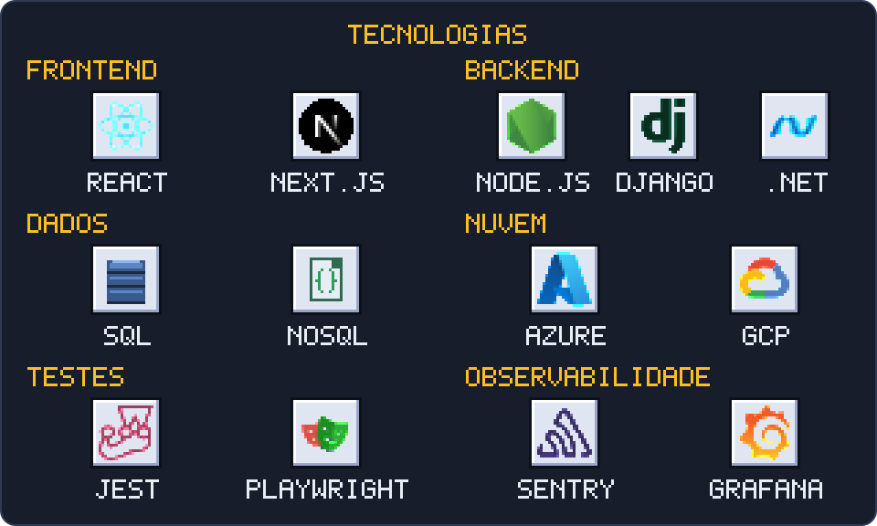

  

## Guyrlam Duque

Desenvolvedor de Software Pleno no Grupo GE21, onde contribuo para a modernização de sistemas legados com React e Django. Atuo na implementação de testes automatizados (unitários e E2E) e na gestão de aplicações na Microsoft Azure, com foco em automação de pipelines de CI/CD e otimização de infraestrutura.

Sou graduando em Mecatrônica, Robótica e Engenharia de Controle e Automação pela Universidade Federal de Minas Gerais (UFMG) e concluí a formação em Desenvolvimento Web pela Alpha EdTech. Tenho experiência sólida em desenvolvimento full stack, com foco em soluções escaláveis e de alta performance.

  

[guyrlam.com](https://guyrlam.com) · [LinkedIn](https://www.linkedin.com/in/guyrlam) · guyrlamsilvaduque@gmail.com
